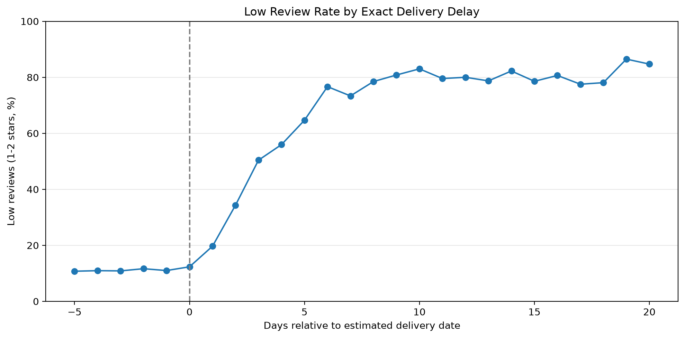
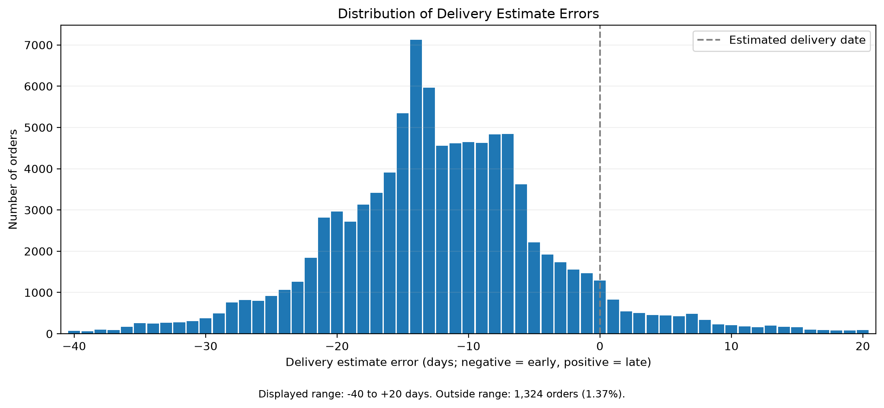
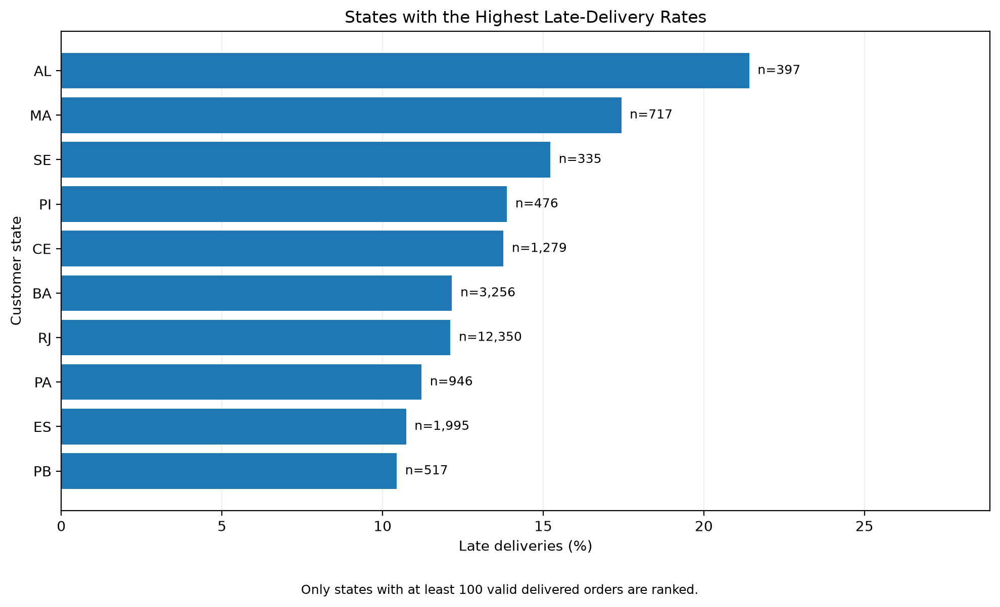
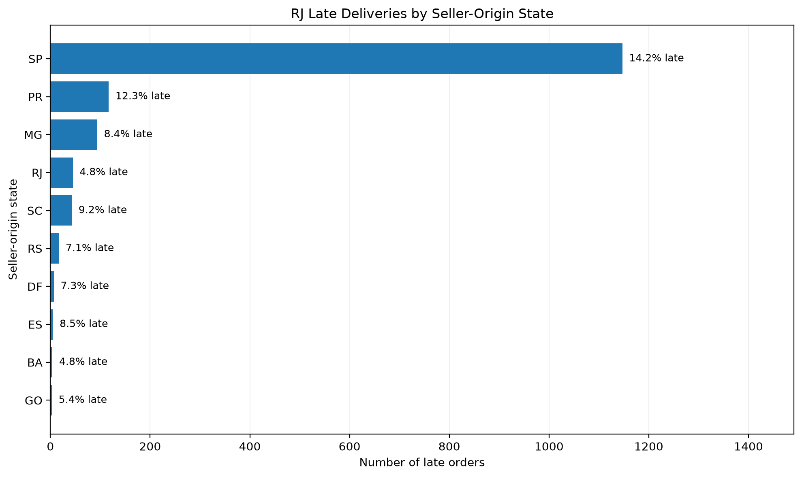
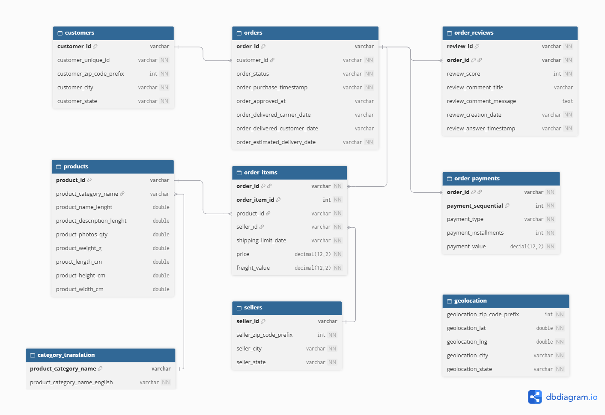
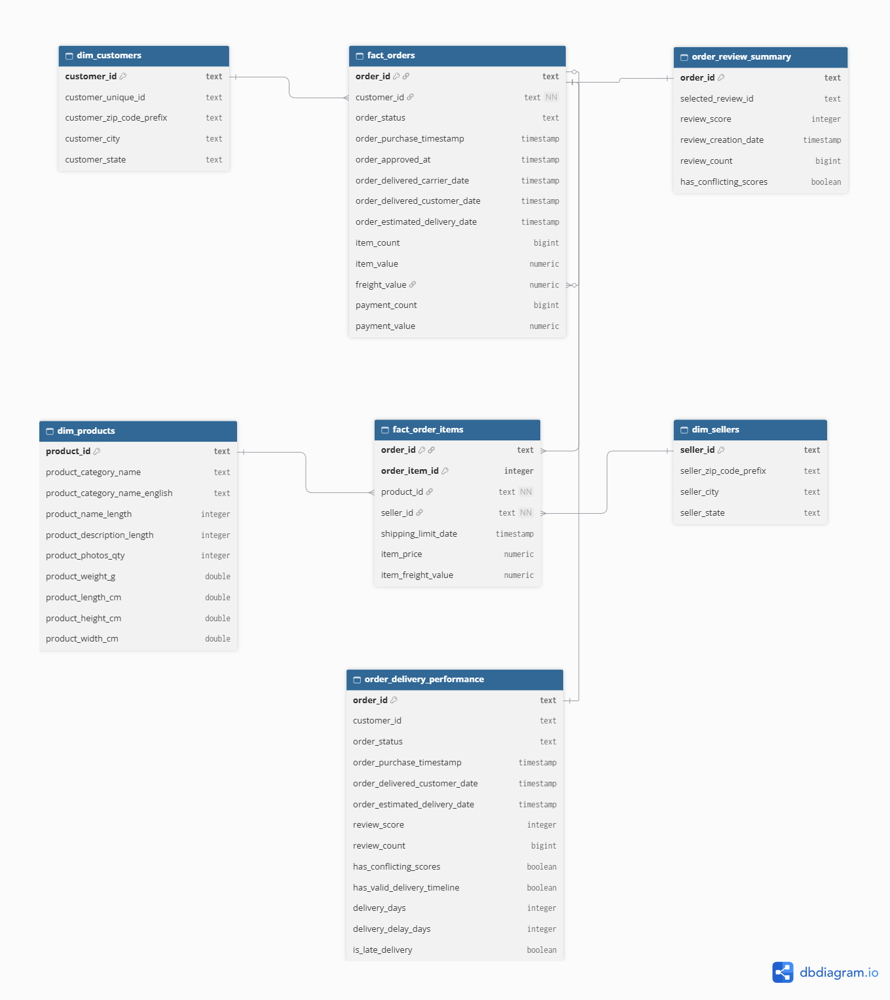

[English](README.md) | **한국어**

# Olist E-Commerce Analytics

### SQL & Python 기반 End-to-End 데이터 분석 프로젝트

브라질 Olist 이커머스 데이터셋을 활용해 배송 신뢰도, 고객 만족도, 지역별 배송 패턴을 분석한 End-to-End 데이터 분석 프로젝트입니다.

이 프로젝트는 재현 가능한 PostgreSQL 데이터 파이프라인을 구축하고, 원천 데이터와 분석용 데이터를 검증하며, 배송 지연과 연관된 운영 요인을 분석합니다.

## 1. 프로젝트 개요

### 비즈니스 문제

배송 성과는 고객 만족도에 영향을 줄 수 있지만, 전체 집계 기준의 배송 지표는 지역별 차이와 운영상의 위험을 가릴 수 있습니다.

이 프로젝트에서는 다음 질문을 분석합니다.

1. 배송 지연은 고객 리뷰 점수와 어떤 관계가 있는가?
2. 예상 배송일은 실제 배송 성과를 얼마나 정확하게 반영하는가?
3. 브라질의 어느 주(州)에서 배송 지연율이 더 높은가?
4. 동일 주 내 배송과 주 간 배송의 패턴은 어떻게 다른가?
5. 리우데자네이루주 고객의 지연 배송에 가장 크게 기여하는 판매자 소재 주는 어디인가?

### 데이터셋

**출처:** Brazilian E-Commerce Public Dataset by Olist (Kaggle)

**데이터셋:** [Brazilian E-Commerce Public Dataset by Olist](https://www.kaggle.com/datasets/olistbr/brazilian-ecommerce)

원본 데이터셋은 주문, 고객, 판매자, 상품, 결제, 리뷰, 주문 상품, 위치 정보, 카테고리 번역 데이터를 담은 9개의 CSV 파일로 구성되어 있습니다.

분석에는 Olist의 과거 거래 데이터를 사용했습니다. 고객 위치와 판매자 위치는 대리 지표(proxy)이며, 실제로 확인된 배송 경로를 반드시 나타내지는 않습니다.

## 2. 주요 분석 결과

### 결과 1 — 배송 지연은 낮은 고객 리뷰 점수와 강하게 연관됨

배송 타임라인이 유효하고 리뷰 점수 간 충돌이 없는 주문을 기준으로 분석한 결과는 다음과 같습니다.

- 조기 배송(예상 배송일 이전 도착): 평균 **4.30 / 5**점
- 1–3일 지연: 평균 **3.29 / 5**점
- 4–7일 지연: 평균 **2.10 / 5**점
- 8–14일 지연: 평균 **1.67 / 5**점

저평점 리뷰 비율은 배송 지연 후 첫 1주일 안에 급격히 증가합니다.



### 결과 2 — 예상 배송일은 전반적으로 보수적으로 설정됨

배송 완료된 유효 주문 96,470건 기준:

| 지표 | 결과 |
|---|---:|
| 평균 예상 배송 기간 | 24.37일 |
| 평균 실제 배송 기간 | 12.50일 |
| 평균 예상 배송일 오차 | -11.88일 |
| 조기 배송 비율 | 91.89% |
| 지연 배송 비율 | 6.77% |

대부분의 주문이 예상 배송일보다 먼저 도착했지만, 배송 신뢰도는 지역 시장별로 차이가 있었습니다.



### 결과 3 — 리우데자네이루주(RJ)의 높은 배송 지연 위험

리우데자네이루주(RJ)의 배송 지연율(**12.11%**)은 상파울루주(SP)의 지연율(**4.49%**)보다 높았습니다.

분포의 상위 꼬리(upper tail) 구간에서도 차이가 나타났습니다.

- RJ: 예상 배송일 오차 P95 +12일
- SP: 예상 배송일 오차 P95 0일
- 심각한 지연(7일 이상) 비율: RJ 7.88%, SP 1.71%

이러한 차이는 평균 예상 배송일 오차만으로는 드러나지 않습니다.



### 결과 4 — RJ 지연 배송의 대부분을 SP 판매자 주문이 차지

분석 조건을 충족하는 RJ 고객 대상 단일 판매자 주문 12,194건 중:

- 8,048건이 SP 판매자의 주문이었습니다.
- 이 중 1,147건이 지연 배송되었습니다.
- SP 판매자 주문이 분석 대상 RJ 지연 주문의 약 77%를 차지했습니다.
- SP 판매자 → RJ 고객 주문의 배송 지연율은 14.25%로, RJ 판매자 → RJ 고객 주문의 4.77%보다 높았습니다.

이 결과는 추가 조사가 필요한 핵심 세그먼트를 보여 주지만, 배송 지연의 원인을 입증하지는 않습니다.



## 3. 데이터 아키텍처

파이프라인은 세 개의 논리 계층으로 구성됩니다.

| 계층 | 목적 |
|---|---|
| Raw | 원본 CSV 파일의 레코드를 원천 구조 그대로 보존 |
| Staging | 데이터 타입, 컬럼명, 식별자 표준화 |
| Analytics | 팩트 테이블, 디멘션 테이블, 배송/리뷰 파생 모델 구축 |

### 원천 데이터 모델



### 분석용 데이터 모델



분석용 모델은 다음 테이블로 구성됩니다.

- `fact_orders`: 주문당 1행
- `fact_order_items`: 주문 상품당 1행
- `dim_customers`: 고객 속성
- `dim_products`: 상품 속성 및 카테고리 번역
- `dim_sellers`: 판매자 속성
- `order_review_summary`: 리뷰가 있는 주문별로 선택된 리뷰와 충돌 플래그
- `order_delivery_performance`: 주문별 배송 및 만족도 지표

### 주요 모델링 결정 사항

**조인 팬아웃(행 중복) 방지:** 주문 상품 및 결제 레코드는 `fact_orders`에 조인하기 전에 주문 단위(grain)로 집계합니다.

**리뷰 처리:** 한 주문에 리뷰가 여러 개 있는 경우, 문서화된 순위 규칙에 따라 가장 최근 리뷰를 선택합니다. 상충하는 리뷰 점수는 플래그로 표시합니다.

**배송 데이터 품질:** 누락되거나 일관되지 않은 배송 타임라인은 보존하되, 유효한 배송일이 필요한 계산에서는 제외합니다.

**지역 분석:** 고객과 판매자의 소재 주를 위치의 대리 지표로 사용합니다. 배송 출발지 패턴을 비교할 때는 단일 판매자 주문을 사용합니다.

자세한 내용은 [아키텍처](docs/architecture.md) 및 [모델링 결정 사항](docs/decisions.md) 문서(영문)를 참고하세요.

## 4. 기술 스택

| 기술 | 용도 |
|---|---|
| PostgreSQL | 관계형 데이터 저장, 데이터 변환, SQL 분석 |
| SQL | 데이터 모델링, 집계, 윈도우 함수, 분석 쿼리, 검증 |
| Python | 분석 워크플로 및 시각화 |
| pandas | SQL 결과 로드 및 차트용 데이터 준비 |
| Matplotlib | 포트폴리오용 시각화 자료 제작 |
| Jupyter | 데이터 프로파일링 및 분석 노트북 |
| DBeaver | 데이터베이스 탐색 및 조회 |
| Git / GitHub | 버전 관리 및 프로젝트 공유 |

## 5. 데이터 품질 및 검증

9개 원천 데이터셋 전체를 대상으로 프로파일링을 수행했습니다.

자동화된 파이프라인은 다음 항목을 검증합니다.

- Raw–Staging 계층 간 행 수 일관성
- 기본 키 및 참조 무결성
- 타임스탬프 및 우편번호 앞자리(ZIP prefix) 표준화
- 금액 지표 정합성(reconciliation)
- 팩트·디멘션 테이블의 그레인(grain)
- 리뷰 요약 데이터 일관성
- 배송 지표 일관성

원천 데이터의 알려진 이상 사항은 임의로 수정하지 않고 문서화했습니다.

자세한 내용은 [데이터 품질 보고서](docs/data_quality.md)(영문)를 참고하세요.

## 6. 프로젝트 재현 방법

### 사전 요구 사항

- PostgreSQL 17
- Python 3
- Windows 환경의 PowerShell
- PATH에 등록된 `psql`
- 로컬에서 실행 중인 PostgreSQL 서버

### 저장소 클론

```bash
git clone https://github.com/royjhan09/ecommerce-analytics.git
cd ecommerce-analytics
```

### 데이터셋 다운로드

Kaggle에서 Brazilian E-Commerce Public Dataset by Olist를 다운로드합니다.

원본 CSV 파일 9개를 다음 경로에 저장합니다.

`data/raw/`

원천 데이터셋은 Git 저장소에 포함되어 있지 않습니다.

### PostgreSQL 설정

현재 로컬 파이프라인은 다음 설정을 기준으로 합니다.

- 호스트: `127.0.0.1`
- 포트: `5432`
- 사용자: `postgres`
- 데이터베이스: `olist_ecommerce`

PostgreSQL 접속 정보는 로컬 환경에서 설정하고, 비밀번호는 저장소에 저장하지 마세요.

### 파이프라인 실행

저장소 루트에서 PowerShell로 다음 명령을 실행합니다.

```powershell
.\scripts\run_pipeline.ps1
```

이 스크립트는 데이터베이스 초기화(필요한 경우), 스키마 생성, 원천 데이터 적재, 스테이징 및 분석용 모델 구축, 자동 검증을 수행합니다.

**주의:** 이 파이프라인은 프로젝트 데이터를 전체 재적재(full refresh)합니다.

### Python 환경

가상 환경을 생성하고 프로젝트 의존성 패키지를 설치합니다.

```powershell
python -m venv .venv
.\.venv\Scripts\Activate.ps1
python -m pip install -r requirements.txt
```

VS Code 또는 Jupyter에서 `notebooks/02_delivery_analysis.ipynb`를 열고, 프로젝트 가상 환경을 커널로 선택합니다.

노트북은 저장된 분석용 SQL 쿼리를 실행하고 포트폴리오 시각화 자료를 다시 생성합니다.

## 7. 프로젝트 문서

상세 문서는 영문으로 작성되어 있습니다.

| 문서 | 설명 |
|---|---|
| [데이터 사전](docs/data_dictionary.md) | 데이터셋 구조, 그레인, 컬럼 |
| [데이터 품질](docs/data_quality.md) | 프로파일링 결과 및 원천 데이터 이상 사항 |
| [아키텍처](docs/architecture.md) | 파이프라인 설계 및 분석용 모델 |
| [결정 사항](docs/decisions.md) | 모델링 선택 및 가정 |
| [비즈니스 분석](docs/analysis.md) | 상세 분석 방법, 결과 및 해석 |

SQL 분석 쿼리는 `sql/analysis/` 디렉터리에 있습니다.

## 8. 한계점 및 향후 과제

- 관찰된 연관성만으로는 인과관계를 입증할 수 없습니다.
- 리뷰 존재 여부와 리뷰 선택 규칙으로 인해 편향이 발생할 수 있습니다.
- 고객 및 판매자의 소재 주만으로는 실제 배송 출발지와 도착지를 검증할 수 없습니다.
- 운송사 배정 정보와 실제 운송 경로는 데이터에서 직접 확인할 수 없습니다.
- 일부 원천 레코드에는 누락되거나 일관되지 않은 타임스탬프가 포함되어 있습니다.
- 과거 데이터를 사용한 분석이므로 현재 마켓플레이스의 성과로 해석해서는 안 됩니다.

향후 확장 방향으로는 판매자별 배송 신뢰도 모니터링, 배송 지연 위험 모델링, 더 상세한 지리 정보 보강, 인터랙티브 운영 대시보드 구축 등을 고려할 수 있습니다.
