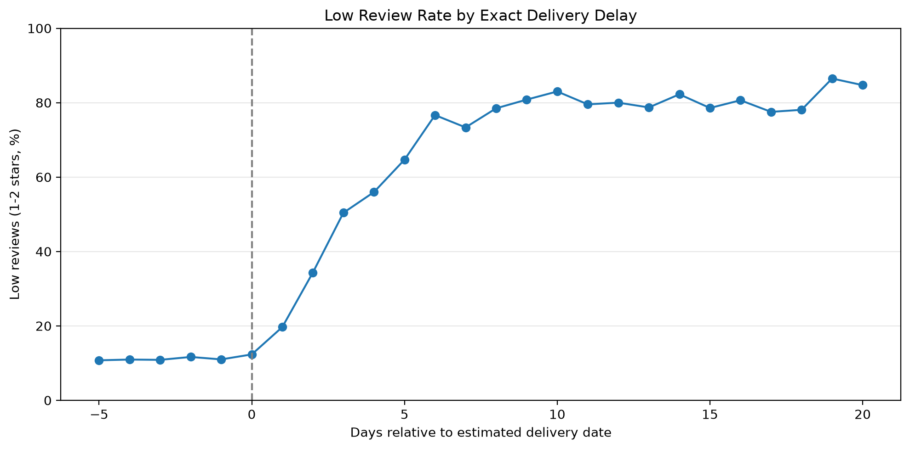
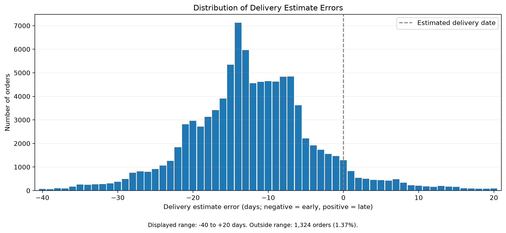
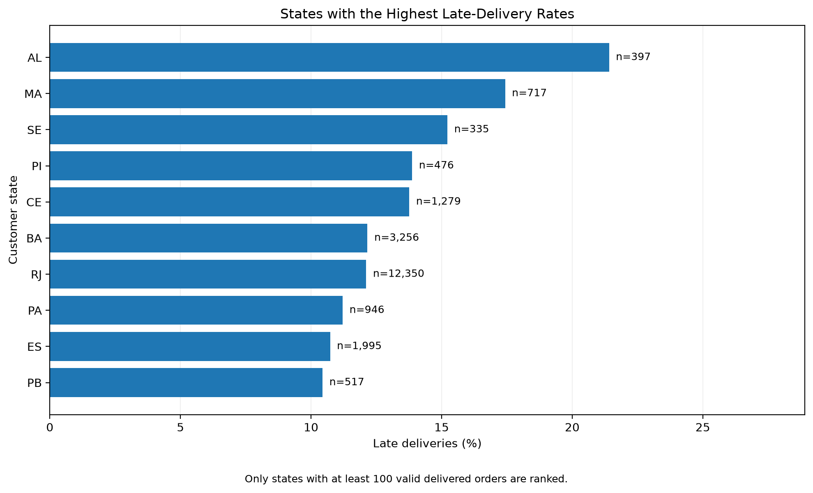
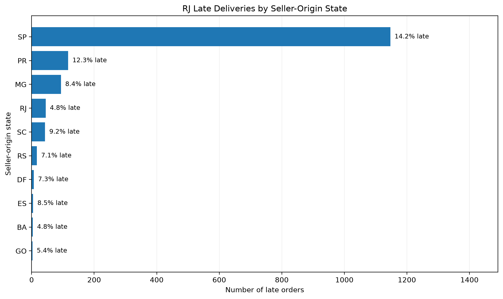
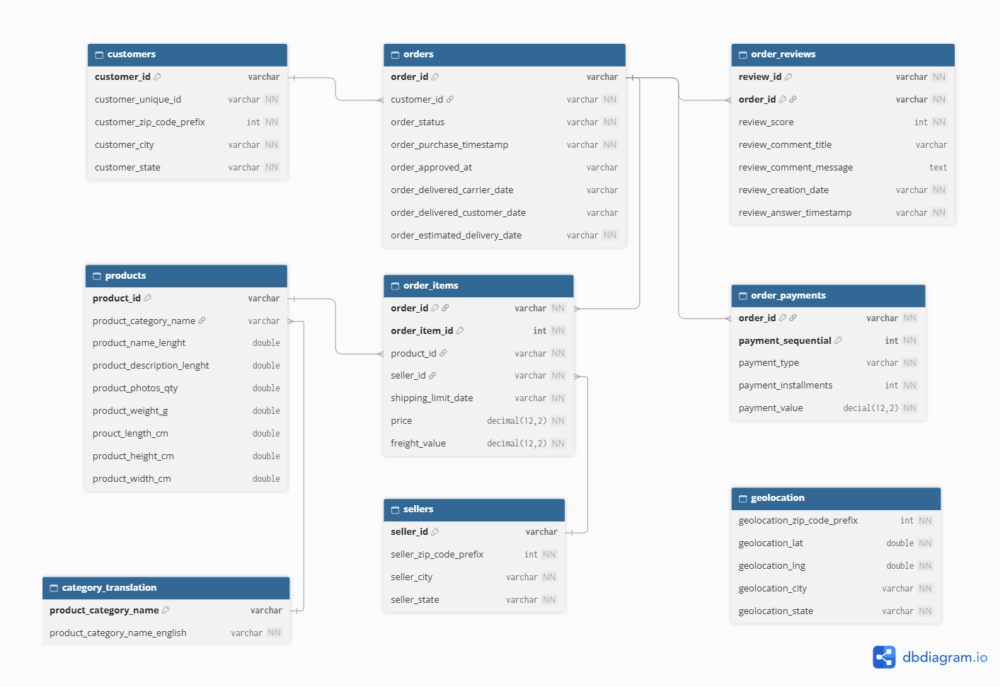
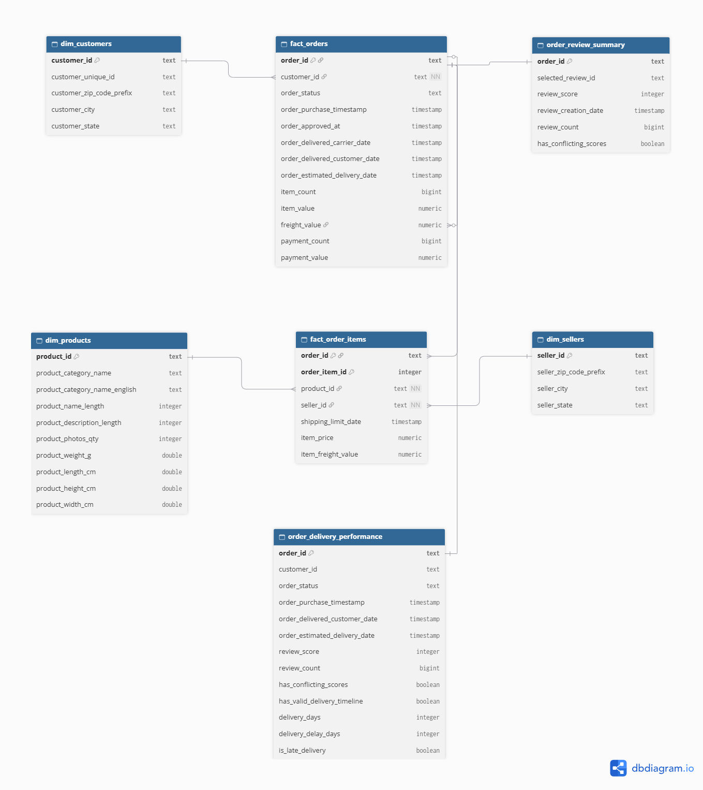

# Olist E-Commerce Analytics

### End-to-End SQL & Python Data Analytics Project

An end-to-end analytics project examining delivery reliability, customer satisfaction, and geographic shipping patterns using the Brazilian Olist e-commerce dataset.

The project builds a reproducible PostgreSQL data pipeline, validates source and analytical data, and investigates operational factors associated with delivery delays.

## 1. Project Overview

### Business Problem

Delivery performance can influence customer satisfaction, but aggregate delivery metrics may conceal geographic differences and operational risks.

This project investigates:

1. How does delivery lateness relate to customer review scores?
2. How accurately do estimated delivery dates reflect actual delivery performance?
3. Which Brazilian states experience higher late-delivery rates?
4. How do same-state and interstate shipping patterns differ?
5. Which seller-origin states contribute most to late deliveries for Rio de Janeiro customers?

### Dataset

**Source:** Brazilian E-Commerce Public Dataset by Olist (Kaggle)

**Dataset:** [Brazilian E-Commerce Public Dataset by Olist](https://www.kaggle.com/datasets/olistbr/brazilian-ecommerce)

The original dataset contains nine CSV files covering orders, customers, sellers, products, payments, reviews, order items, geolocation, and category translations.

The analysis uses historical Olist transaction data. Customer location and seller location are proxies and do not necessarily represent verified shipping routes.

## 2. Key Findings

### Finding 1 — Delivery delays are strongly associated with poor customer reviews

Among orders with valid delivery timelines and non-conflicting review scores:

- Early deliveries averaged **4.30 / 5** stars.
- Deliveries 1–3 days late averaged **3.29 / 5** stars.
- Deliveries 4–7 days late averaged **2.10 / 5** stars.
- Deliveries 8–14 days late averaged **1.67 / 5** stars.

Low-review rates increase sharply within the first week of lateness.



### Finding 2 — Delivery estimates were generally conservative

Across 96,470 valid delivered orders:

| Metric | Result |
|---|---:|
| Average promised delivery time | 24.37 days |
| Average actual delivery time | 12.50 days |
| Average estimate error | -11.88 days |
| Delivered early | 91.89% |
| Delivered late | 6.77% |

Most orders arrived before their estimated date, although delivery reliability differed across geographic markets.



### Finding 3 — Rio de Janeiro has an elevated late-delivery risk

Rio de Janeiro had a late-delivery rate of **12.11%**, compared with **4.49%** in São Paulo.

Upper-tail outcomes also differed:

- RJ: P95 delivery estimate error of +12 days.
- SP: P95 delivery estimate error of 0 days.
- Severe lateness (7+ days): RJ 7.88%, SP 1.71%.

These differences are not apparent from average delivery-estimate errors alone.



### Finding 4 — Orders associated with SP sellers account for most RJ delays

Among 12,194 qualifying single-seller deliveries to RJ customers:

- 8,048 orders were associated with SP sellers.
- 1,147 of these orders were late.
- SP sellers accounted for approximately 77% of qualifying RJ late orders.
- The SP-seller-to-RJ-customer late-delivery rate was 14.25%, compared with 4.77% for RJ sellers serving RJ customers.

This identifies an important segment for further investigation, but does not establish the cause of delivery delays.



## 3. Data Architecture

The pipeline follows three logical layers:

| Layer | Purpose |
|---|---|
| Raw | Preserve source-aligned records from the original CSV files |
| Staging | Standardize data types, column names, and identifiers |
| Analytics | Build fact tables, dimensions, and derived delivery/review models |

### Source Data Model



### Analytical Data Model



The analytical model includes:

- `fact_orders`: One row per order
- `fact_order_items`: One row per order item
- `dim_customers`: Customer attributes
- `dim_products`: Product attributes and category translations
- `dim_sellers`: Seller attributes
- `order_review_summary`: Selected review and conflict flags per reviewed order
- `order_delivery_performance`: Delivery and satisfaction metrics per order

### Important Modeling Decisions

**Preventing join fanout:** Item and payment records are aggregated to the order grain before joining into `fact_orders`.

**Review handling:** When multiple reviews exist for an order, the latest review is selected through a documented ranking rule. Conflicting review scores are flagged.

**Delivery quality:** Missing and inconsistent delivery timelines are preserved but excluded from calculations requiring valid delivery dates.

**Geographic analysis:** Customer and seller states are used as location proxies. Single-seller orders are used when comparing shipping-origin patterns.

Additional details are documented in [Architecture](docs/architecture.md) and [Modeling Decisions](docs/decisions.md).

## 4. Technology Stack

| Technology | Usage |
|---|---|
| PostgreSQL | Relational storage, transformations, and SQL analysis |
| SQL | Data modeling, aggregations, window functions, analytical queries, and validation |
| Python | Analytical workflow and visualization |
| pandas | Loading SQL results and preparing charts |
| Matplotlib | Creating portfolio figures |
| Jupyter | Data profiling and analytical notebooks |
| DBeaver | Database exploration and inspection |
| Git / GitHub | Version control and project distribution |

## 5. Data Quality and Validation

Source profiling was performed across all nine datasets.

The automated pipeline validates:

- Raw and staging row-count consistency
- Primary-key and relationship integrity
- Timestamp and ZIP-prefix standardization
- Financial measure reconciliation
- Fact and dimension grains
- Review summary consistency
- Delivery metric consistency

Known source anomalies are documented rather than silently modified.

See [Data Quality Report](docs/data_quality.md).

## 6. Reproducing the Project

### Prerequisites

- PostgreSQL 17
- Python 3
- PowerShell on Windows
- `psql` available on PATH
- PostgreSQL server running locally

### Clone the Repository

```bash
git clone https://github.com/royjhan09/ecommerce-analytics.git
cd ecommerce-analytics
```

### Download the Dataset

Download the Brazilian E-Commerce Public Dataset by Olist from Kaggle.

Place the nine original CSV files into:

`data/raw/`

The source datasets are not included in the Git repository.

### Configure PostgreSQL

The current local pipeline assumes:

- Host: `127.0.0.1`
- Port: `5432`
- User: `postgres`
- Database: `olist_ecommerce`

Configure PostgreSQL credentials locally. Do not store passwords in the repository.

### Run the Pipeline

From the repository root in PowerShell:

```powershell
.\scripts\run_pipeline.ps1
```

The script initializes the database if necessary, creates schemas, loads the source data, builds staging and analytical models, and executes automated validation.

**Warning:** This pipeline performs a full refresh of project data.

### Python Environment

Create a virtual environment and install project dependencies:

```powershell
python -m venv .venv
.\.venv\Scripts\Activate.ps1
python -m pip install -r requirements.txt
```

Open `notebooks/02_delivery_analysis.ipynb` in VS Code or Jupyter and select the project virtual environment.

The notebook executes saved analytical SQL queries and regenerates the portfolio visualizations.

## 7. Project Documentation

| Document | Description |
|---|---|
| [Data Dictionary](docs/data_dictionary.md) | Dataset structure, grain, and columns |
| [Data Quality](docs/data_quality.md) | Profiling findings and source anomalies |
| [Architecture](docs/architecture.md) | Pipeline design and analytical models |
| [Decisions](docs/decisions.md) | Modeling choices and assumptions |
| [Business Analysis](docs/analysis.md) | Detailed methods, results, and interpretation |

SQL analysis queries are located in `sql/analysis/`.

## 8. Limitations and Future Work

- Observational relationships do not establish causality.
- Review availability and review-selection rules may introduce bias.
- Customer and seller states do not verify actual shipment origin and destination.
- Carrier assignments and physical transportation routes are not directly available.
- Some source records contain missing or inconsistent timestamps.
- Analyses use historical data and should not be interpreted as current marketplace performance.

Potential extensions include seller-level reliability monitoring, delivery-risk modeling, more detailed geographic enrichment, and an interactive operational dashboard.
