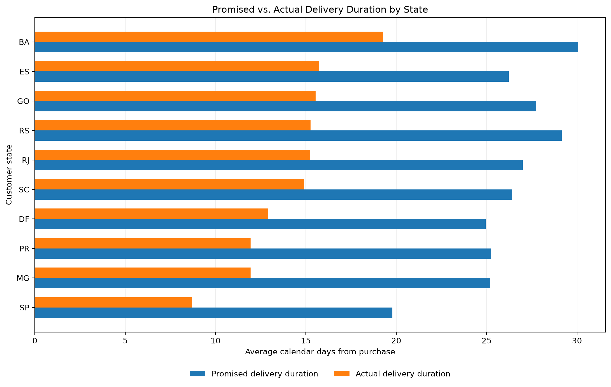
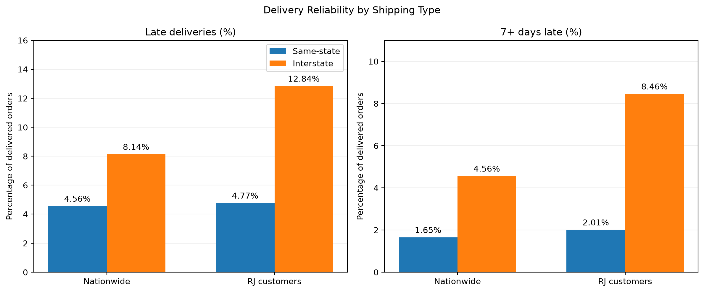

# Business Analysis

## 1. Delivery Delay Severity vs Customer Reviews

### Business Question

How does customer satisfaction vary with delivery delay severity?

### Data and Methodology

- Source: 'analytis.order_delivery_performance'
- Grain: One row per order
- Population: Delivered orders with valid delivery timelines and available review scores
- Orders with conflicting review scores are excluded from the baseline
- Delivery delay is calculated using calender dates
- Low-review rate: Percentage of reviews with scores of 1 or 2
- Delay segments: Early, On time, 1-3, 4-7, 8-14, and 15+ days late

### Results

| Delivery Segment | Reviewed Orders | Avg. Review Score | Low Review % | Five-Star % |
|---|---:|---:|---:|---:|
| Early | 87,994 | 4.30 | 9.19% | 62.50% |
| On time | 1,273 | 4.04 | 12.33% | 50.75% |
| 1-3 days late | 1,850 | 3.29 | 32.16% | 33.19% |
| 4-7 days late | 1,745 | 2.10 | 67.62% | 14.10% |
| 8-14 days late | 1,443 | 1.67 | 80.25% | 6.86% |
| 15+ days late | 1,330 | 1.72 | 78.35% | 7.22% |

Total qualifying orders: 95,635.

### Key Findings

1. Customer satisfaction is strongly associated with delivery delay severity.
2. The low-review rate increases from 9.19% for early deliveries to 67.62% for deliveries 4-7 days late.
3. The largest adjacent-segment decline in average review score occurs between 1-3 days late (3.29) and 4-7 days late (2.10).
4. Review scores remain very low for delays exceeding one week, with no clear further deterioration between the 8-14 and 15+ day segments.
5. Approximately 92.0% of qualifying orders were delivered earlier than their estimated delivery dates.

### Business Implication

- Delivery delays appear to be a significant indicator of customer dissatisfaction. 
- Orders approaching several days of lateness warrant closer operational investigation.
- The high early-delivery rate raises questions about the accuracy and conservatism of estimated delivery dates.

These implications are hypotheses for further investigation, not demonstrated causal effects.

### Limitations

- Observational relationships do not establish causality.
- Orders without reviews are excluded.
- Orders with conflicting review scores are excluded from the baseline.
- Delay categories are analyst-defined.
- Product, seller, and geographic differences may influence review scores.
- Delivery dates represent calender-day comparisons rather than exact elapsed hours.

### Visualization

### Reproductibility

SQL: 'sql/analysis/01_delivery_delay_vs_reviews.sql'

## 2. Daily Delivery Delay vs Customer Reviews

### Business Question

Does customer dissatisfaction increase gradually with each additional day of delivery delay, or is there evidence of a distinct turning point?

### Methodology

- Source: 'analytics.order_delivery_performance'
- Grain: One row per order
- Population: Valid delivered orders with reviews, excluding conflicting-score orders
- Analysis window: 5 days early through 20 days late
- Metrics: Average review score, low-review rate (1-2 stars), five-star rate, and reviewed order count

### Key Findings

1. **Dissatisfaction begins increasing immediately after the estimated delivery date.** Low-review rates rise from 12.33% on time to 19.68% at one day late and 34.33% at two days late.

2. **By three days late, approximately half of reviews are negative.** The low-review rate reaches 50.40% among 496 reviewed orders. 

3. **The strongest deterioration occurs during the first week.** By six days late, average review score falls to 1.81, and the low-review rate reaches 76.66%

4. **Satisfaction remains low beyond approximately one week.** Between days 8 and 20, average scores generally range from 1.51 to 1.73, without a clear continued downward trend. 

5. **No single abrupt threshold is established.** The earlier 4-7-day segment finding reflects a broader deterioration beginning during the first few days of lateness.

### Business Implications

- Monitor deliveries approaching or exceeding their estimated delivery dates.
- Investigate proactive customer notifications and shipment escalation policies.
- Prioritize evaluation of interventions within the first few days of lateness. 

These are proposed operational responses, not interventions demonstrated to be effective by this analysis. 

### Limitations

- The analysis is observational and cannot establish causality.
- Review availability may introduce selection bias.
- Conflicting-score orders are excluded.
- Delay is measured using calender dates rather than elapsed hours.
- Sampel sizes decrease for longer delays, increasing estimate variability.
- The analysis is restricted to the -5 through +20 day window.

### Visualization

### Reproductibility

SQL: 'sql/analysis/02_daily_delay_pattern.sql'

## 3. Delivery Estimate Accuracy

### Business Question

How accurately do estimated delivery dates reflect actual delivery performance?

### Methodology

- Source: `analytics.order_delivery_performance`
- Population: Delivered orders with valid delivery timelines
- Grain: One row per order
- Review availability is not required
- Calculations use calendar-day differences

### Results

| Metric | Result |
|---|---:|
| Valid delivered orders | 96,470 |
| Average promised duration | 24.37 days |
| Average actual duration | 12.50 days |
| Average signed estimate error | -11.88 days |
| Average signed error among early deliveries | -13.71 days |
| Early deliveries | 91.89% |
| On-time deliveries | 1.34% |
| Late deliveries | 6.77% |

### Key Findings

1. Estimated delivery dates are substantially later than actual delivery dates for most qualifying orders.
2. Actual delivery duration averages 12.50 days, compared with a promised duration of 24.37 days.
3. Approximately 91.89% of qualifying deliveries arrive before the estimated date.
4. Extreme early-delivery observations warrant further investigation before assessing estimate accuracy.
5. The delivery estimate error distribution is concentrated on the early-delivery side, with a visible peak around 14 days early.
6. The distribution includes extreme observations. The visualization displays errors from -40 to +20 days; 1,324 orders (1.37%) lie outside that range.
7. The median delivery estimate error is 12 days, compared with the mean of -11.88 days.

### Business Implications

Delivery estimates appear conservative. Further analysis should determine whether this reflects deliberate operational buffers, variation across sellers or regions, or data-quality issues.

The results do not establish that the estimates are incorrectly calibrated for their intended business purpose.

### Visualization

### Reproducibility

- `sql/analysis/03_delivery_estimate_accuracy.sql`
- `sql/analysis/04_delivery_estimate_distribution.sql`
- `notebooks/02_delivery_analysis.ipynb`

## 4. Geographic Delivery Performance

### Business Question

Which customer states experience the highest delivery-delay rates, and which account for the greatest number of late orders?

### Methodology

- Sources: 'analytics.order_delivery_performance' and 'analytics.dim_customers'
- Grain: One row per order before state-level aggregation
- Population: Orders with valid delivery timelines
- Geography: Customer state, used as a proxy for delivery destination
- Metrics: Delivered orders, late orders, late-delivery rate
- Rate ranking: States with at least 100 valid delivered orders

### Key Findings

1. Late-delivery rates vary substantially across Brazilian states.
2. Alagos (AL) and Maranhao (MA) have particularly high rates, approximately 20% in the visualization.
3. Sao Paulo (SP) has the highest absolute late-order count, with 1,820 late deliveries, despite a rate of 4.49%.
4. Rio de Janeiro (RJ) combines substantial order volume with a high late-delivery rate: 1,495 late orders out of 12,350 deliveries (12.11%).
5. Geographic prioritization should consider both the rate of lateness and the absolute number of affected orders.

### Business Implications

- Investigate RJ as a potential operational improvement opportunity.
- Examine high-rate states such as AL and MA to understand whether delivery-distance, seller-location, or estimate-setting differences contribute to performance. 
- Distinguish high-volume operational impact from high relative delivery risk.

### Limitations

- Customer state is a proxy for delivery destination.
- Differences between states do not establish geographic causality.
- Shipment distance, carrier, seller mix, and other confounding factors have not yet been controlled.
- Smaller states have less precise estimates due to lower order counts.

### Visualization

### Reproductibility

SQL: 'sql/analysis/05_delivery_performance_by_state.sql'

### Delivery Window Comparison

A comparison of state-level promised and actual delivery durations reveals that delivery speed and deivery reliability are not interchangeable.

- Sao Paulo (SP): 8.70 actual days, 19.78 promised days, 4.49% late.
- Rio de Janeiro (RJ): 15.24 actual days, 27.00 promised days, 12.11% late.
- Rio Grande do Sul (RS): 15.25 actual days, 29.16 promised days, 6.08% late.
- Alagoas (AL): 24.50 actual days, 33.21 promised days, 21.41% late.
- Amazonas (AM): 26.36 actual days, 45.92 promised days, 2.76% late.

RJ and RS have similar average actual delivery durations but substantially different late-delivery rates.

This indicates that average delivery duration alone cannot explain state-level lateness. Differences in delivery-date variability, promised windows, and underlying order composition require further investigation.

**Limitations:** These are descriptive state-level comparisons. They do not establish teh causes of differences, and smaller states have greater sampling uncertainty.

**SQL:** 'sql/analysis/06_delivery_windows_by_state.sql'

### Delivery Window Visualization

The chart compares average promised and actual delivery durations across the ten states with the highest valid deliveried-order volumes.

The chart shows state-level differences in delivery speed and promised delivery windows. These averages do not, by themselves, explain differences in late-delivery rates.

**Source:** 'sql/analysis/06_delivery_windows_by_state.sql'

### Delivery Reliability: Distribution and Tail Risk

Analysis 07 examines delivery estimate errors using medians, upper percentiles, and severe-lateness rates for five major states.

| State | Median Error | P90 Error | P95 Error | 7+ Days Late |
|---|---:|---:|---:|---:|
| BA | -12 | +3 | +9 | 6.66% |
| RJ | -13 | +3 | +12 | 7.88% |
| RS | -15 | -3 | +2 | 3.44% |
| SP | -11 | -3 | 0 | 1.71% |
| MG | -14 | -4 | 0 | 1.97% |

#### Key Findings

1. RJ's median delivery error is -13 days, indicating that a typical delivery arrives before its estimated date.
2. RJ's P95 delivery error is +12 days, compared with 0 days in SP and MG.
3. Severe lateness (7+ days) affects 7.88% of RJ deliveries, compared with 1.71% in SP.
4. Similar average delivery estimate errors can conceal substantially different late-delivery risks.
5. Delivery reliability should be evaluated using both typical performance and upper-tail delays.

#### Business Implications

RJ is a priority for investigating severe delivery delays due to its combination of substantial order volume and poor upper-tail performance.

Future analysis should examine seller locations and shipping patterns to idenitfy potential contributors.

#### Limitations

- Percentiles describe observed delivery outcomes, not their causes.
- Customer state is used as a proxy for delivery destination.
- Seller, carrier, distance, and product-mix effects have not been controlled.
- These descriptive differences do not establish causality.

**SQL:** 'sql/analysis/07_delivery_reliability_by_state.sql'

## 5. Interstate Shipping and Delivery Performance

### Business Question

Are interstate orders associated with longer delivery durations and higher late-delivery rates, particularly among customers in Rio de Janeiro?

### Methodology

- Source: `analytics.order_delivery_performance`, `analytics.fact_order_items`, `analytics.dim_customers`, and `analytics.dim_sellers`
- Grain: One row per order
- Population: Valid delivered orders with exactly one distinct seller
- Coverage: 95,195 of 96,470 valid delivered orders (98.68%)
- Excluded: 1,275 multi-seller orders
- Same-state: Seller and customer states match
- Interstate: Seller and customer states differ
- Customer state serves as a proxy for delivery destination

### Results

| Population | Shipping Type | Orders | Avg. Actual Days | Late % | 7+ Days Late % |
|---|---|---:|---:|---:|---:|
| Nationwide | Same-state | 34,234 | 7.90 | 4.56% | 1.65% |
| Nationwide | Interstate | 60,961 | 15.15 | 8.14% | 4.56% |
| RJ customers | Same-state | 943 | 6.54 | 4.77% | 2.01% |
| RJ customers | Interstate | 11,251 | 16.03 | 12.84% | 8.46% |

### Key Findings

1. Nationwide, interstate orders have a late-delivery rate of 8.14%, compared with 4.56% for same-state orders.
2. Interstate orders have longer average delivery durations even though their promised delivery windows are also longer.
3. For RJ customers, interstate orders have a late-delivery rate of 12.84%, compared with 4.77% for same-state orders.
4. Severe lateness (7+ days) affects 8.46% of RJ interstate orders, compared with 2.01% of RJ same-state orders.
5. Approximately 92.27% of qualifying RJ single-seller orders are interstate.

### Business Implications

Interstate shipping is an important candidate for further investigation, especially for RJ customers.

A useful next step is to identify which seller-origin states account for the greatest number and proportion of severely late RJ deliveries.

### Limitations

- This is an observational comparison, not a causal estimate.
- Customer state is a proxy for delivery destination.
- Orders with multiple distinct sellers are excluded.
- Differences in route distance, seller mix, product characteristics, carriers, and promised delivery windows may influence the results.
- Seller state does not necessarily identify the physical warehouse or dispatch location.

### Visualization

### Reproducibility

SQL: `sql/analysis/08_interstate_delivery_performance.sql`

Notebook: `notebooks/02_delivery_analysis.ipynb`

## 6. Seller-Origin Analysis for Rio de Janeiro

### Business Question

Which seller-origin states account for the greatest number of late deliveries to RJ customers?

### Methodology

- Sources: Order delivery performance, order-item fact, customer and seller dimensions
- Grain: One row per order before aggregation
- Population: Valid delivered orders to RJ customers with exactly one distinct seller
- Qualifying orders: 12,194
- Seller state is a location proxy, not a verified dispatch origin
- Lateness: Delivery after the estimated calendar date
- Severe lateness: At least seven calendar days late

### Results

| Seller State | Orders | Late Orders | Late % | 7+ Days Late % |
|---|---:|---:|---:|---:|
| SP | 8,048 | 1,147 | 14.25% | 9.46% |
| PR | 951 | 117 | 12.30% | 7.99% |
| MG | 1,124 | 94 | 8.36% | 5.07% |
| RJ | 943 | 45 | 4.77% | 2.01% |
| SC | 465 | 43 | 9.25% | 6.24% |

### Key Findings

1. SP sellers account for 8,048 qualifying RJ orders, approximately 66.0% of the population.
2. Of the 1,490 late deliveries to RJ, 1,147 (77.0%) are associated with SP sellers.
3. The SP-origin late-delivery rate is 14.25%, compared with 4.77% for RJ-origin orders.
4. SP-origin orders include 761 severe-late deliveries, representing a 9.46% severe-lateness rate.
5. SP is a priority for further operational investigation because it combines high order volume with elevated lateness risk.

### Business Implications

Prioritize investigation of orders associated with SP sellers and delivered to RJ customers.

Potential investigation areas include fulfillment timing, handoff processes, carrier performance, and delivery-estimate calibration.

These are hypotheses for operational evaluation, not confirmed causes of lateness.

### Limitations

- Seller state does not necessarily indicate the physical shipping origin.
- Customer state is used as a destination proxy.
- Multi-seller orders are excluded.
- Observational differences do not establish causality.
- Product mix, seller characteristics, carriers, and actual shipping distances are not controlled.

### Visualization

### Reproducibility

- SQL: `sql/analysis/09_rj_shipping_origins.sql`
- Notebook: `notebooks/02_delivery_analysis.ipynb`
