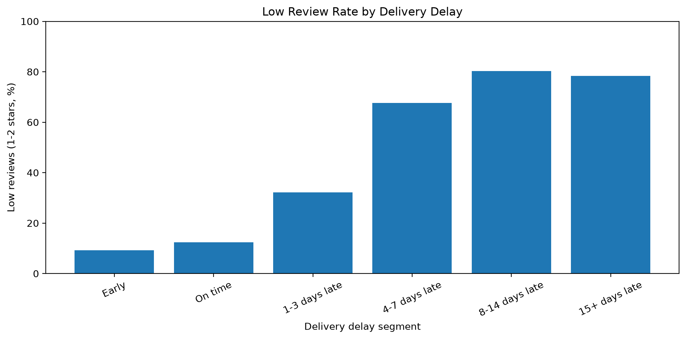

# Business Analysis

## 1. Delivery Delay Severity vs Customer Reviews

### Business Question

How does customer satisfaction vary with delivery delay severity?

### Data and Methodology

- Source: 'analytis.order_delivery_performance'
- Grain: One row per order
- Population: Delivered orders with valid delivery timelines and available review scores
- Orders with conflicting review scores are excluded from the baseline
- Delivery delay is calculated using calender dates
- Low-review rate: Percentage of reviews with scores of 1 or 2
- Delay segments: Early, On time, 1-3, 4-7, 8-14, and 15+ days late

### Results

| Delivery Segment | Reviewed Orders | Avg. Review Score | Low Review % | Five-Star % |
|---|---:|---:|---:|---:|
| Early | 87,994 | 4.30 | 9.19% | 62.50% |
| On time | 1,273 | 4.04 | 12.33% | 50.75% |
| 1-3 days late | 1,850 | 3.29 | 32.16% | 33.19% |
| 4-7 days late | 1,745 | 2.10 | 67.62% | 14.10% |
| 8-14 days late | 1,443 | 1.67 | 80.25% | 6.86% |
| 15+ days late | 1,330 | 1.72 | 78.35% | 7.22% |

Total qualifying orders: 95,635.

### Key Findings

1. Customer satisfaction is strongly associated with delivery delay severity.
2. The low-review rate increases from 9.19% for early deliveries to 67.62% for deliveries 4-7 days late.
3. The largest adjacent-segment decline in average review score occurs between 1-3 days late (3.29) and 4-7 days late (2.10).
4. Review scores remain very low for delays exceeding one week, with no clear further deterioration between the 8-14 and 15+ day segments.
5. Approximately 92.0% of qualifying orders were delivered earlier than their estimated delivery dates.

### Business Implication

- Delivery delays appear to be a significant indicator of customer dissatisfaction. 
- Orders approaching several days of lateness warrant closer operational investigation.
- The high early-delivery rate raises questions about the accuracy and conservatism of estimated delivery dates.

These implications are hypotheses for further investigation, not demonstrated causal effects.

### Limitations

- Observational relationships do not establish causality.
- Orders without reviews are excluded.
- Orders with conflicting review scores are excluded from the baseline.
- Delay categories are analyst-defined.
- Product, seller, and geographic differences may influence review scores.
- Delivery dates represent calender-day comparisons rather than exact elapsed hours.

### Visualization

### Reproductibility

SQL: 'sql/analysis/01_delivery_delay_vs_reviews.sql'

## 2. Daily Delivery Delay vs Customer Reviews

### Business Question

Does customer dissatisfaction increase gradually with each additional day of delivery delay, or is there evidence of a distinct turning point?

### Methodology

- Source: 'analytics.order_delivery_performance'
- Grain: One row per order
- Population: Valid delivered orders with reviews, excluding conflicting-score orders
- Analysis window: 5 days early through 20 days late
- Metrics: Average review score, low-review rate (1-2 stars), five-star rate, and reviewed order count

### Key Findings

1. **Dissatisfaction begins increasing immediately after the estimated delivery date.** Low-review rates rise from 12.33% on time to 19.68% at one day late and 34.33% at two days late.

2. **By three days late, approximately half of reviews are negative.** The low-review rate reaches 50.40% among 496 reviewed orders. 

3. **The strongest deterioration occurs during the first week.** By six days late, average review score falls to 1.81, and the low-review rate reaches 76.66%

4. **Satisfaction remains low beyond approximately one week.** Between days 8 and 20, average scores generally range from 1.51 to 1.73, without a clear continued downward trend. 

5. **No single abrupt threshold is established.** The earlier 4-7-day segment finding reflects a broader deterioration beginning during the first few days of lateness.

### Business Implications

- Monitor deliveries approaching or exceeding their estimated delivery dates.
- Investigate proactive customer notifications and shipment escalation policies.
- Prioritize evaluation of interventions within the first few days of lateness. 

These are proposed operational responses, not interventions demonstrated to be effective by this analysis. 

### Limitations

- The analysis is observational and cannot establish causality.
- Review availability may introduce selection bias.
- Conflicting-score orders are excluded.
- Delay is measured using calender dates rather than elapsed hours.
- Sampel sizes decrease for longer delays, increasing estimate variability.
- The analysis is restricted to the -5 through +20 day window.

### Visualization

### Reproductibility

SQL: 'sql/analysis/02_daily_delay_pattern.sql'